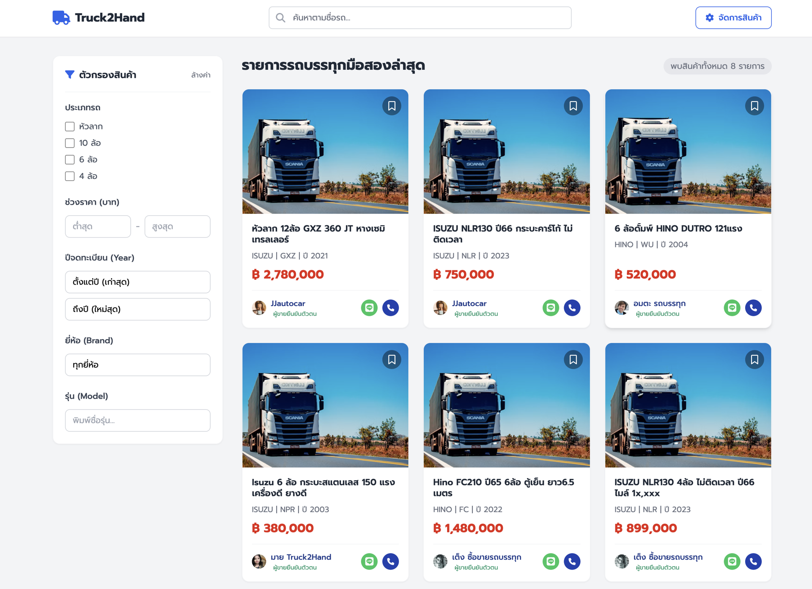
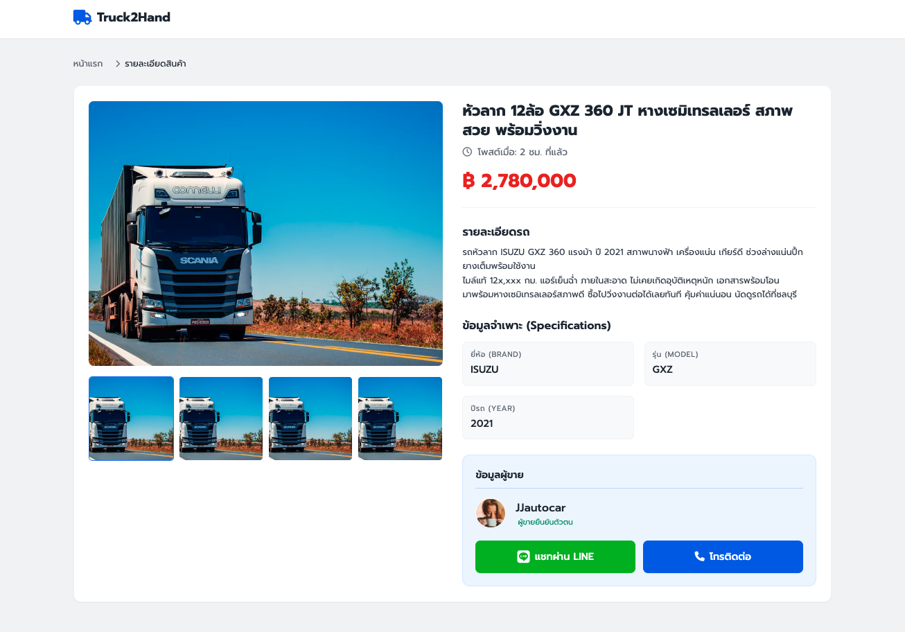
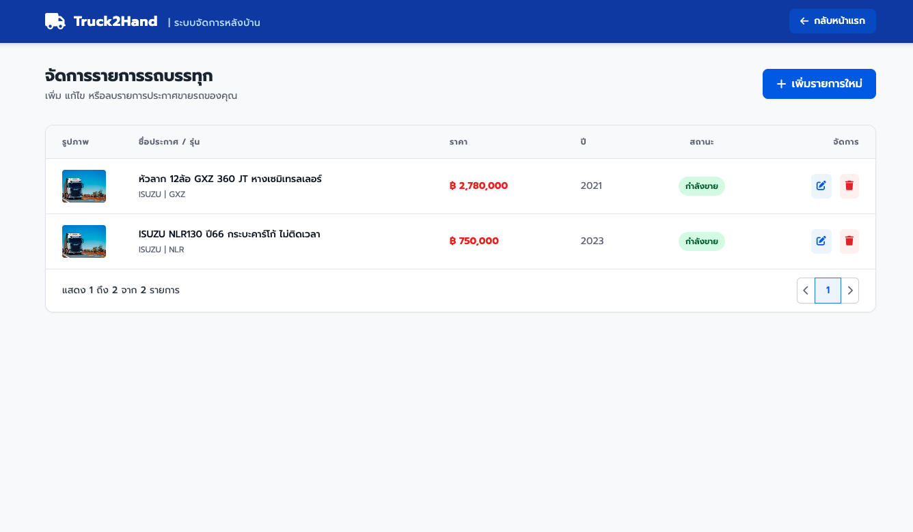
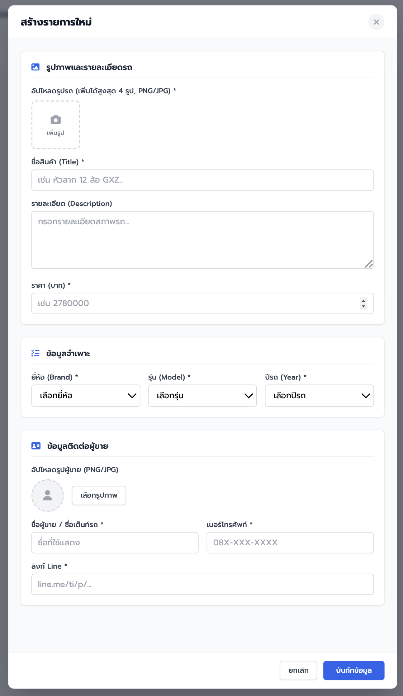
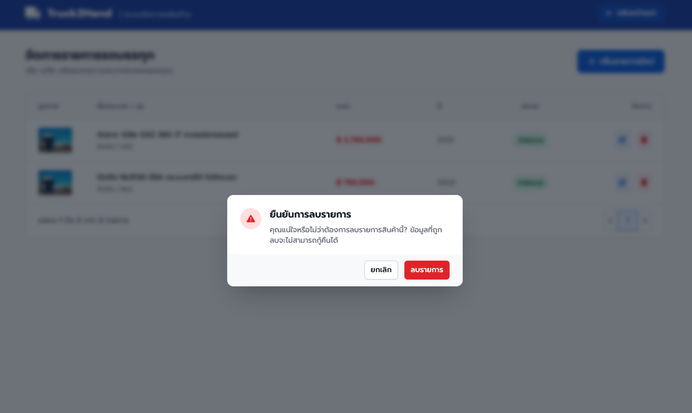

# AI Academy Coding

A hands-on demo of using Cursor agents to build a web application from a written brief.

You start the loop with one message. **app-conductor** then spawns **app-architect** and **app-builder** until the task board is finished or a stop rule fires. You run the finished app, or you investigate when the loop stops early. The product they build is **Truck2Hand**, a marketplace for second-hand trucks.

The application source is not in this repository yet. This tree is the brief, the UI references, and the agent setup.

Thai version: [README_TH.md](README_TH.md).

## Before you start

Check out the exercise branch:

```text
git switch autonomous-agents-ex02
```

- Open this repository in Cursor and use **Agent** chat.
- Start the loop with `/app-conductor`. The conductor spawns the architect and the builder. You do not call them for each task.
- Node.js **24.20.0** is the runtime the brief pins (`.nvmrc` is created during the build). You need it when you run the finished app. On macOS/Linux use nvm or fnm with `.nvmrc`; on Windows use nvm-windows, fnm, or the official installer for the same version.
- Backend install compiles `better-sqlite3`: macOS needs Xcode Command Line Tools; Windows needs Visual Studio Build Tools (C++). Agents document this in **How to run**.
- The architect creates a git branch named `cursor/<slug>`. The agents do not commit or push unless you ask.

## Repository structure

```text
.
├── .cursor/
│   ├── agents/
│   │   ├── app-conductor.md      # schedules architect and builder
│   │   ├── app-architect.md      # design and task-board agent
│   │   └── app-builder.md        # implementation and QA agent
│   └── skills/
│       ├── app-delivery-contracts/SKILL.md
│       ├── app-conductor-playbook/SKILL.md
│       ├── app-architect-playbook/SKILL.md
│       └── app-builder-playbook/SKILL.md
├── docs/
│   ├── REQUIREMENTS.md           # product source of truth
│   └── specs/                    # acceptance criteria, API, database, UI images
├── backend/src/db/demo-photos/   # seed listing photos
└── README.md
```

### Agents

An agent is a role Cursor can run as a subagent. Each file under `.cursor/agents/` is one role.

| Agent | Invoke | What it does |
| --- | --- | --- |
| `app-conductor` | `/app-conductor` | Spawns the architect and the builder in turn. Writes `docs/LOOP.md`. Stops when the board is finished or a stop rule fires. It does not design or write application code. |
| `app-architect` | Spawned by the conductor, or `/app-architect` | Reads the requirements, writes the design and the task board, and later marks tasks done from QA reports. It does not write application code or start the builder. |
| `app-builder` | Spawned by the conductor, or `/app-builder` | Implements **one** task, runs tests, and writes a QA report. It marks that task `implemented` only when tests pass. It does not mark tasks `done` or start the architect. |

### Skills

A skill is a markdown playbook in `.cursor/skills/<name>/SKILL.md`. It is not an agent. The agent files tell each role to read its skills before doing any work, so the same rules apply every run.

| Skill | Who reads it | What it is for |
| --- | --- | --- |
| `app-delivery-contracts` | All three agents | Which requirements file to use, the git branch name, which doc each agent may edit, and the rules for running tasks at the same time. |
| `app-conductor-playbook` | `app-conductor` | How to hand off between the other two agents, what to store in `docs/LOOP.md`, and when to stop for a person. |
| `app-architect-playbook` | `app-architect` | How to write `docs/DESIGN.md`, `docs/TASKS.md`, and `docs/RUN.md`, how to read a QA report, and the two-round fix limit. |
| `app-builder-playbook` | `app-builder` | How to implement a single task, run tests once, and write `docs/QA-REPORT-<id>.md`. |

## How the demo runs

### 1. Start the loop

```text
/app-conductor
```

The conductor reads `docs/REQUIREMENTS.md` unless you pass another path (`/app-conductor docs/REQUIREMENTS.md`). It spawns the architect, then the builder, then the architect again, one task at a time.

On the first architect run the architect:

- creates the app branch and writes `docs/GITBRANCH.md`
- writes `docs/DESIGN.md` and `docs/TASKS.md`
- records a start time in `docs/RUN.md`

Each task has an id (`T1`, `T2`, …), a `files` list, and `depends_on`. A dependency must be `implemented` or `done` before a later task starts. The conductor writes every handoff to `docs/LOOP.md` (phase, board snapshot, and a handoff log). That file is how a stopped session resumes.

For each task the builder implements only that task’s files, runs the tests once, and writes `docs/QA-REPORT-<id>.md`. A pass sets the task to `implemented`. The architect then sets it to `done`, or adds a fix task (`T1-FIX1`, then at most `T1-FIX2`). The conductor runs that fix task next. The loop does not commit.

### 2. Optional kickoff flags

Pause after the task board exists, so you can read it before any code is written:

```text
/app-conductor pause after design
```

`review the plan first` and `stop after the task board` mean the same pause. When you are ready:

```text
/app-conductor continue
```

Serial is the default. To let the conductor run a wave of tasks the architect marked as safe together:

```text
/app-conductor allow parallel
```

An open fix task still runs alone. If a parallel wave leaves unmerged worktrees, the conductor stops. It does not merge or commit.

### 3. When the loop stops

| Stop reason | What happened | What you do |
| --- | --- | --- |
| `board complete` | Every task is `done`, or nothing is left `open` or `implemented`. | Read **How to run** in `docs/RUN.md` and try the app. |
| `fix limit` | A task still failed after `FIX2`. The rest of the board does not continue. | Read `docs/LOOP.md`, that task’s QA report, and its notes. |
| `paused after design` | The board exists and no builder has run. | Read `docs/TASKS.md`, then `/app-conductor continue`. |
| `no progress` | The board did not change after a handoff, or no task was eligible. | Read the handoff log in `docs/LOOP.md`. |
| `handoff cap` | The builder was started three times for one original task. | Same as a fix-limit investigation. |
| `scope expanded` | A new feature task appeared after the design. | Read `docs/TASKS.md`. |
| `missing QA report` | The builder finished without a QA file. | Read the builder’s last reply and `docs/LOOP.md`. |
| `parallel merge failed` | A parallel wave used other worktrees. | The log lists the paths. Do not expect a merge commit. |

A session that dies mid-loop leaves **phase** as `design`, `build`, or `qa`. Start again with `/app-conductor continue`. If **phase** is `stopped`, the conductor waits until you say the investigation is done, for example `/app-conductor continue after investigation`.

The conductor does not start the dev server. Checking the screens in a browser is your step, after `board complete`.

### 4. Run the application

When the stop reason is `board complete`, follow **How to run** in `docs/RUN.md`. That section is also copied into `docs/DESIGN.md`. Use those commands to install dependencies, run tests, and start the app.

### Manual handoff

You can still call the other two agents yourself. Neither starts the other.

```text
/app-architect
/app-builder Implement T1
/app-architect Review the new QA reports and update the task board
```

On a pass the architect sets the task to `done`. On a fail it adds `T1-FIX1`, then at most `T1-FIX2`. In this manual path you choose whether to continue other tasks after a fix line stops. The conductor path stops the whole run instead.

### Task status

| Status | Meaning |
| --- | --- |
| `open` | Not built yet, or a new fix task. |
| `implemented` | Builder finished and tests passed. Waiting for the architect. |
| `done` | Architect accepted a passing QA report. |
| `failed` | QA failed for that row. A fix task (`FIX1`, then `FIX2`) may still be open. The conductor stops the whole run only after `FIX2` is `failed`. |

## The application

**Truck2Hand** is a small used-truck marketplace. The UI copy is Thai. There is no login. Anyone can open the back office from the header.

| Page | Route | What you can do |
| --- | --- | --- |
| Home | `/` | Browse a grid of listings. Filter by vehicle type, price, year, brand, and model. Sort by newest, price, or most viewed. |
| Listing detail | `/products/:id` | See the gallery, description, vehicle facts, and seller. Call the seller or use the LINE button. |
| Manage listings | `/manage` | Table of listings. Create, edit, or delete. Create and edit use one form. Delete asks for confirmation. |

Stack, pinned in `docs/specs/definition-of-done.md`:

- **Frontend:** Vue 3, vue-router, Vite, plain CSS. Dev server `http://localhost:5173`.
- **Backend:** Express 5, Drizzle ORM, SQLite. API `http://localhost:8080`, Swagger at `/api-docs`.

The full behaviour, validation rules, and API shape are in `docs/REQUIREMENTS.md` and `docs/specs/`. Agents must not add features that are not listed there.

### What the screens are meant to look like

These images are a visual guide for layout and tone. They are not a second specification. When a picture and `docs/REQUIREMENTS.md` disagree, follow the written requirements.

The built pages will not match these images exactly. Agents interpret the brief, so spacing, colours, labels, and which controls appear can differ. That difference is expected.

**Home** — header, filters, and a card grid:



**Listing detail** — gallery on the left, price and seller on the right:



**Manage listings** — table with edit and delete:



**Create a listing** — modal form for a new truck:



**Delete** — confirmation before the listing is removed:



**Warning:** several things in the pictures are out of scope and must not be built. That includes the home search box, card bookmarks, a listing status column, and some of the headings and button labels. Examples:

| Picture | Shown in the image | What to build |
| --- | --- | --- |
| Home | Search box, bookmarks, result count, vehicle-type checkboxes | No search box and no bookmarks. One vehicle-type select, a brand-dependent model dropdown, and the four sort options. |
| Manage | Status column ("กำลังขาย"), heading "ระบบจัดการหลังบ้าน" | Story 3 columns and the heading "ระบบจัดการสินค้า". No status column. |
| Delete | Solid red "ลบรายการ" button | Confirm with "ยืนยันการลบสินค้านี้?". Delete stays a quiet red control. |
| Detail | "โพสต์เมื่อ", buttons "แชทผ่าน LINE" / "โทรติดต่อ" | Buttons are "ติดต่อผู้ขาย" and "แอดไลน์". No "โพสต์เมื่อ". |
| Create | No vehicle-type field, LINE marked required | Show ประเภทรถ and the verified-seller checkbox. LINE is optional. |

The full list is the table “Screenshot differences” in `docs/REQUIREMENTS.md`.

## Files the agents add

| File | Written by | Purpose |
| --- | --- | --- |
| `docs/GITBRANCH.md` | Architect | Branch name and the requirements path |
| `docs/DESIGN.md` | Architect | Modules, data, UI, and how to run |
| `docs/TASKS.md` | Architect owns the board; a builder may set only its own task to `implemented` | The task board |
| `docs/RUN.md` | Architect | Start and end time, QA log, summary, and how to run |
| `docs/LOOP.md` | Conductor | Phase, stop reason, board snapshot, and handoff log |
| `docs/QA-REPORT-<id>.md` | Builder | Test result for that task |

After the board is complete, follow **How to run** in `docs/RUN.md` to install, test, and open the app.
