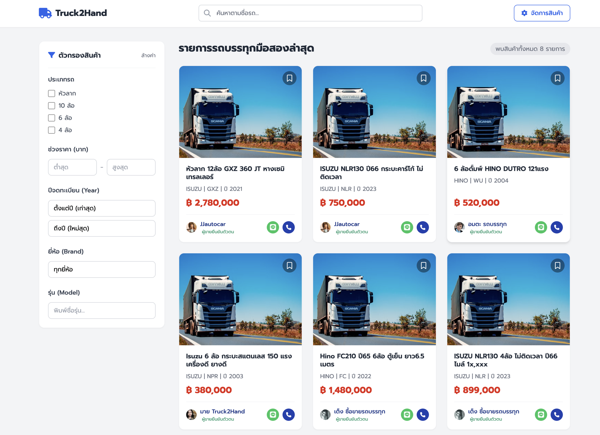
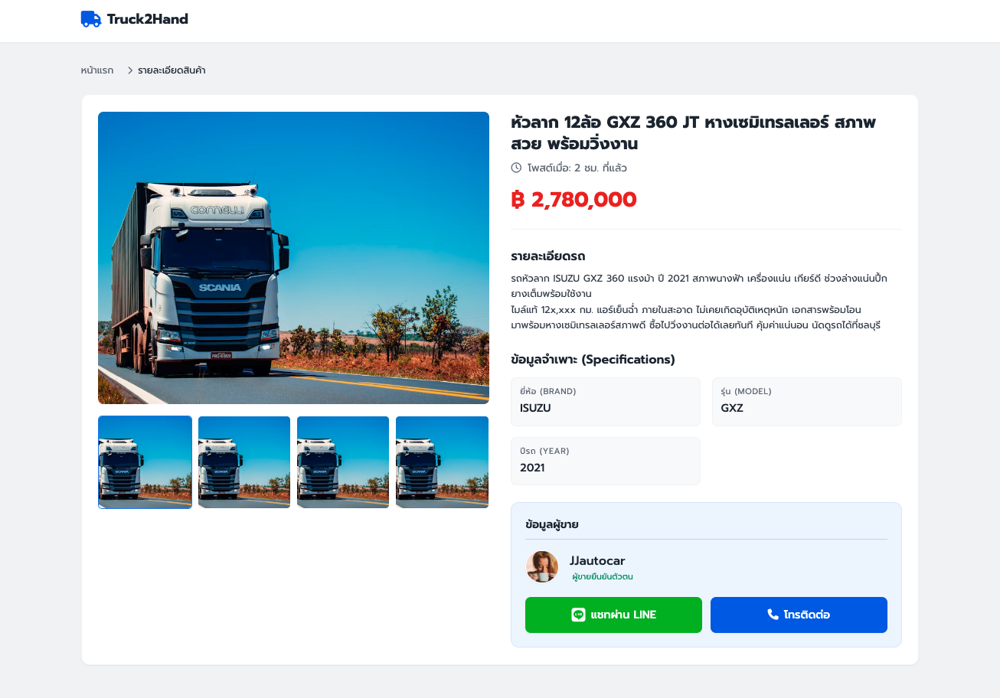
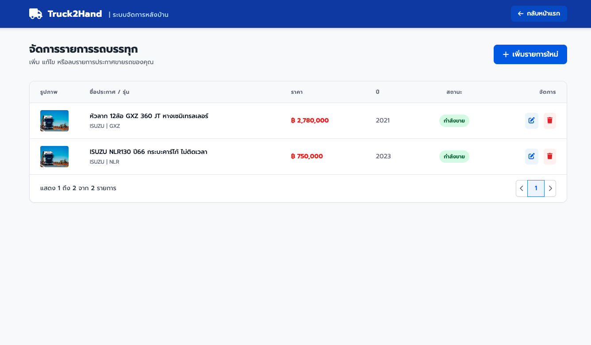
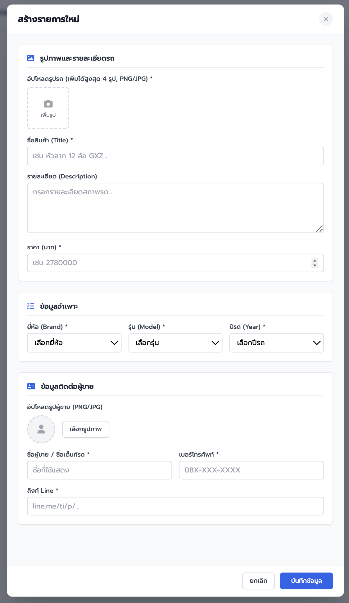
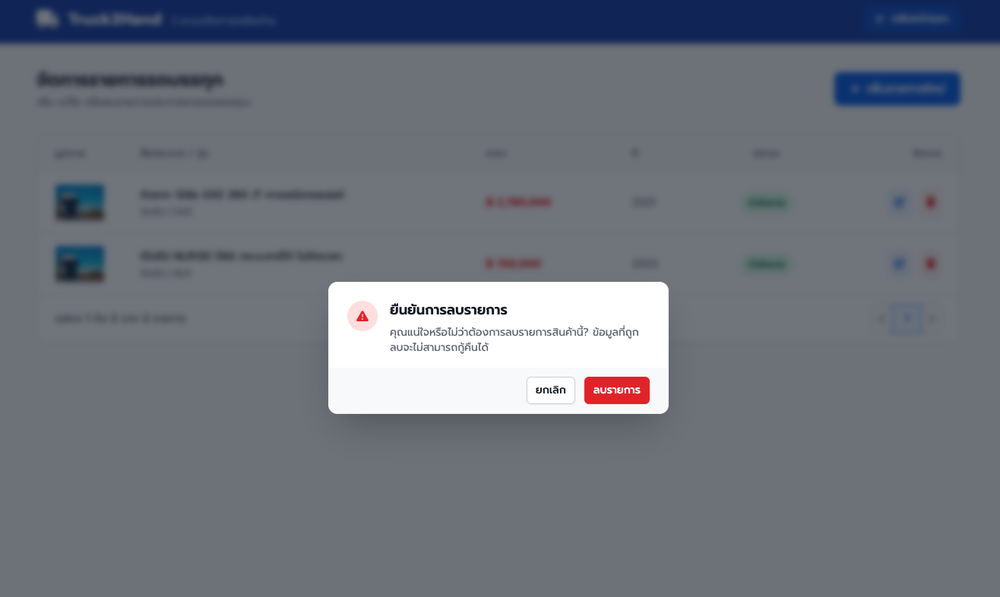

# AI Academy Coding

เดโมสำหรับทดลองใช้ Cursor agents สร้างเว็บแอปพลิเคชันจากเอกสารความต้องการ

คุณอยู่ในแชตแล้วเรียกเอเจนต์สองตัวเอง **app-architect** อ่านความต้องการแล้วแตกเป็นงานย่อย **app-builder** ลงมือทำแต่ละงานแล้วเขียนรายงาน QA จากนั้นคุณส่ง architect กลับไปอ่านรายงานนั้นแล้วปรับสถานะงานเป็นเสร็จ ผลิตภัณฑ์ที่เอเจนต์สร้างคือ **Truck2Hand** ตลาดซื้อขายรถบรรทุกมือสอง

ซอร์สของแอปพลิเคชันยังไม่อยู่ในรีพอซิทอรีนี้ ต้นไม้ไฟล์นี้คือโจทย์ ภาพอ้างอิง UI และการตั้งค่าเอเจนต์

ฉบับภาษาอังกฤษ: [README.md](README.md)

## ก่อนเริ่ม

สลับไปที่บรานช์ของแบบฝึกหัด:

```text
git switch agents-ex02
```

- เปิดรีพอซิทอรีนี้ใน Cursor แล้วใช้แชต **Agent**
- เรียกเอเจนต์เองด้วย `/app-architect` และ `/app-builder` การส่งต่องานเป็นแบบแมนนวล เอเจนต์จะไม่เริ่มอีกตัวให้
- Node.js **24.20.0** คือรันไทม์ที่โจทย์กำหนด (ไฟล์ `.nvmrc` จะถูกสร้างระหว่างการพัฒนา) ต้องมีเมื่อจะรันแอปที่สร้างเสร็จแล้ว
- เอเจนต์จะสร้างกิตบรานช์ชื่อ `cursor/<slug>` และจะไม่ commit หรือ push จนกว่าคุณจะสั่ง

## โครงสร้างรีพอซิทอรี

```text
.
├── .cursor/
│   ├── agents/
│   │   ├── app-architect.md      # เอเจนต์ออกแบบและดูแลบอร์ดงาน
│   │   └── app-builder.md        # เอเจนต์ลงมือทำและทำ QA
│   └── skills/
│       ├── app-delivery-contracts/SKILL.md
│       ├── app-architect-playbook/SKILL.md
│       └── app-builder-playbook/SKILL.md
├── docs/
│   ├── REQUIREMENTS.md           # แหล่งความจริงของผลิตภัณฑ์
│   └── specs/                    # เกณฑ์ยอมรับ, API, ฐานข้อมูล, ภาพ UI
├── backend/src/db/demo-photos/   # รูปภาพรายการตัวอย่าง
└── README.md
```

### เอเจนต์

เอเจนต์คือบทบาทที่ Cursor รันเป็นซับเอเจนต์ได้ แต่ละไฟล์ใน `.cursor/agents/` คือหนึ่งบทบาท

| เอเจนต์ | วิธีเรียก | หน้าที่ |
| --- | --- | --- |
| `app-architect` | `/app-architect` | อ่านความต้องการ เขียนแบบและบอร์ดงาน แล้วภายหลังปรับงานเป็น `done` จากรายงาน QA ไม่เขียนโค้ดแอปพลิเคชัน |
| `app-builder` | `/app-builder` | ลงมือทำ **หนึ่ง** งาน รันเทส และเขียนรายงาน QA จะตั้งสถานะงานนั้นเป็น `implemented` เฉพาะเมื่อเทสผ่าน ไม่ปรับงานเป็น `done` |

แชตของคุณคือผู้ประสานงาน เมื่อ architect เสร็จ คุณจึงเริ่ม builder เมื่อ builder เสร็จ คุณจึงเริ่ม architect อีกครั้ง

### สกิล

สกิลคือเพลย์บุ๊กมาร์กดาวน์ใน `.cursor/skills/<name>/SKILL.md` ไม่ใช่เอเจนต์ ไฟล์เอเจนต์สั่งให้แต่ละบทบาทอ่านสกิลของตนก่อนลงมือ เพื่อให้ใช้กฎชุดเดียวกันทุกครั้ง

| สกิล | ใครอ่าน | ใช้ทำอะไร |
| --- | --- | --- |
| `app-delivery-contracts` | ทั้งสองเอเจนต์ | ไฟล์ความต้องการที่จะใช้ ชื่อกิตบรานช์ เอกสารที่แต่ละเอเจนต์แก้ได้ และกฎการรันงานพร้อมกัน |
| `app-architect-playbook` | `app-architect` | วิธีเขียน `docs/DESIGN.md`, `docs/TASKS.md`, และ `docs/RUN.md` วิธีอ่านรายงาน QA และขีดจำกัดการแก้สองรอบ |
| `app-builder-playbook` | `app-builder` | วิธีลงมือทำหนึ่งงาน รันเทสหนึ่งครั้ง และเขียน `docs/QA-REPORT-<id>.md` |

## ลำดับของเดโม

### 1. ออกแบบ

เริ่มด้วย:

```text
/app-architect
```

architect อ่าน `docs/REQUIREMENTS.md` (หรือพาธอื่นถ้าคุณส่งให้ เช่น `/app-architect docs/REQUIREMENTS.md`) ในการรันครั้งแรกจะ:

- สร้างบรานช์ของแอปและเขียน `docs/GITBRANCH.md`
- เขียน `docs/DESIGN.md` และ `docs/TASKS.md`
- บันทึกเวลาเริ่มใน `docs/RUN.md`
- บอกงานถัดไปหนึ่งงาน และบอกว่ารหัสงานใดรันพร้อมกันได้

แต่ละงานมีรหัส (`T1`, `T2`, …) รายการ `files` และ `depends_on` งานที่ถูกอ้างใน `depends_on` ต้องเป็น `implemented` หรือ `done` ก่อน งานถัดไปจึงเริ่มได้

### 2. สร้าง

ค่าเริ่มต้นคืองานเดียว:

```text
/app-builder Implement T1
```

ถ้ารันทุกงานที่ architect บอกว่าทำพร้อมกันได้ ให้คัดลอกรหัสเหล่านั้นแล้วบอกให้ทำในเวลาเดียวกัน:

```text
/app-builder Implement T2, T3, and T5 at the same time
```

`in parallel` มีความหมายเดียวกัน ใส่รหัสจากชุดที่ architect บอกว่างานรอบนี้ทำได้ งานที่ยังขึ้นกับงานที่ยังไม่เสร็จ หรือแกไฟล์ชุดเดียวกัน ให้อยู่รอบถัดไป builder จะไม่เริ่มชุดนั้น และจะบอกว่ารหัสใดไปด้วยกันได้

แต่ละงาน builder จะแก้เฉพาะไฟล์ของงานนั้น รันเทสหนึ่งครั้ง แล้วเขียน `docs/QA-REPORT-<id>.md` ถ้าผ่าน จะตั้งสถานะเป็น `implemented` ถ้าไม่ผ่าน งานจะยังเป็น `open`

### 3. ตรวจรับงาน

ส่ง architect กลับเข้ามา:

```text
/app-architect Review the new QA reports and update the task board
```

ถ้าผ่าน จะตั้งงานเป็น `done` ถ้าไม่ผ่าน จะเพิ่มงานแก้ (`T1-FIX1` แล้วได้มากสุด `T1-FIX2`) คุณรัน `/app-builder` กับงานแก้นั้น แล้วรัน `/app-architect` อีกครั้ง ถ้ารอบแก้สองรอบยังไม่ผ่าน architect จะตั้งงานเดิมเป็น `failed` แล้วหยุดสายงานนั้น

ทำขั้นที่ 2 และ 3 ซ้ำจนกว่าบอร์ดจะไม่มีงาน `open` หรือ `implemented` จากนั้น architect จะเขียนเวลาจบ ระยะเวลา และ **How to run** ลงใน `docs/RUN.md`

### 4. รันแอปพลิเคชัน

เมื่องานทุกรายการเป็น `done` แล้ว (หรือบอร์ดหยุดหลังครบขีดจำกัดการแก้) ให้ทำตาม **How to run** ใน `docs/RUN.md` ส่วนเดียวกันนี้ถูกคัดลอกไปที่ `docs/DESIGN.md` ด้วย ใช้คำสั่งเหล่านั้นเพื่อติดตั้งดิเพนเดนซี รันเทส และสตาร์ตแอป ทำขั้นนี้หลังบอร์ดเสร็จสมบูรณ์แล้วเท่านั้น

### สถานะของงาน

| สถานะ | ความหมาย |
| --- | --- |
| `open` | ยังไม่ได้สร้าง หรือเป็นงานแก้ใหม่ |
| `implemented` | builder ทำเสร็จและเทสผ่าน รอ architect |
| `done` | architect ยอมรับรายงาน QA ที่ผ่าน |
| `failed` | QA ยังไม่ผ่านหลังแก้สองรอบ |

## แอปพลิเคชัน

**Truck2Hand** คือตลาดรถบรรทุกมือสองขนาดเล็ก ข้อความบน UI เป็นภาษาไทย ไม่มีระบบล็อกอิน ใครก็เปิดหลังบ้านได้จากปุ่มบนหัวเว็บ

| หน้า | เส้นทาง | สิ่งที่ทำได้ |
| --- | --- | --- |
| หน้าแรก | `/` | ดูกริดรายการรถ กรองตามประเภทรถ ราคา ปี ยี่ห้อ และรุ่น เรียงตามใหม่สุด ราคา หรือดูมากที่สุด |
| รายละเอียดรายการ | `/products/:id` | ดูแกลเลอรี รายละเอียด ข้อมูลรถ และผู้ขาย โทรหาผู้ขายหรือใช้ปุ่ม LINE |
| จัดการรายการ | `/manage` | ตารางรายการ สร้าง แก้ไข หรือลบ การสร้างและแก้ไขใช้ฟอร์มเดียวกัน การลบมีหน้าต่างยืนยัน |

สแตกที่ปักไว้ใน `docs/specs/definition-of-done.md`:

- **ฟรอนต์เอนด์:** Vue 3, vue-router, Vite, CSS ธรรมดา เซิร์ฟเวอร์พัฒนาที่ `http://localhost:5173`
- **แบ็กเอนด์:** Express 5, Drizzle ORM, SQLite API ที่ `http://localhost:8080` Swagger ที่ `/api-docs`

พฤติกรรมทั้งหมด กฎการตรวจสอบ และรูปแบบ API อยู่ใน `docs/REQUIREMENTS.md` และ `docs/specs/` เอเจนต์ต้องไม่เพิ่มฟีเจอร์ที่ไม่ได้ระบุไว้

### หน้าตาที่คาดหวัง

ภาพเหล่านี้เป็นแนวทางของเลย์เอาต์และโทน ไม่ใช่สเปกชุดที่สอง เมื่อภาพกับ `docs/REQUIREMENTS.md` ไม่ตรงกัน ให้ทำตามเอกสารที่เขียนไว้

หน้าที่สร้างเสร็จจะไม่ตรงกับภาพทุกพิกเซล เอเจนต์ตีความโจทย์ ดังนั้นระยะห่าง สี ป้ายข้อความ และคอนโทรลที่ปรากฏอาจต่างกัน ความต่างนี้เป็นสิ่งที่คาดไว้

**หน้าแรก** — หัวเว็บ ตัวกรอง และกริดการ์ด:



**รายละเอียดรายการ** — แกลเลอรีด้านซ้าย ราคาและผู้ขายด้านขวา:



**จัดการรายการ** — ตารางพร้อมปุ่มแก้ไขและลบ:



**สร้างรายการ** — ฟอร์มโมดัลสำหรับรถคันใหม่:



**ลบ** — หน้าต่างยืนยันก่อนลบรายการ:



**คำเตือน:** หลายอย่างในภาพอยู่นอกขอบเขตและห้ามสร้าง รวมถึงช่องค้นหาบนหน้าแรก บุ๊กมาร์กบนการ์ด คอลัมน์สถานะรายการ และหัวข้อหรือป้ายปุ่มบางส่วน ตัวอย่าง:

| ภาพ | สิ่งที่ปรากฏในภาพ | สิ่งที่ต้องสร้าง |
| --- | --- | --- |
| หน้าแรก | ช่องค้นหา บุ๊กมาร์ก จำนวนผลลัพธ์ ช่องติ๊กประเภทรถ | ไม่มีช่องค้นหาและไม่มีบุ๊กมาร์ก ใช้ตัวเลือกประเภทรถแบบเลือกได้หนึ่งค่า ดรอปดาวน์รุ่นที่ขึ้นกับยี่ห้อ และตัวเลือกการเรียงสี่แบบ |
| จัดการ | คอลัมน์สถานะ ("กำลังขาย") หัวข้อ "ระบบจัดการหลังบ้าน" | คอลัมน์และหัวข้อตาม Story 3 คือ "ระบบจัดการสินค้า" ไม่มีคอลัมน์สถานะ |
| ลบ | ปุ่มแดงทึบ "ลบรายการ" | ยืนยันด้วย "ยืนยันการลบสินค้านี้?" ปุ่มลบใช้สไตล์แดงแบบเรียบ |
| รายละเอียด | "โพสต์เมื่อ" ปุ่ม "แชทผ่าน LINE" / "โทรติดต่อ" | ปุ่มคือ "ติดต่อผู้ขาย" และ "แอดไลน์" ไม่มี "โพสต์เมื่อ" |
| สร้าง | ไม่มีช่องประเภทรถ และทำเครื่องหมายว่า LINE จำเป็น | แสดงประเภทรถและช่องติ๊กผู้ขายยืนยันตัวตน LINE ไม่บังคับ |

รายการเต็มอยู่ในตาราง “Screenshot differences” ใน `docs/REQUIREMENTS.md`

## ไฟล์ที่เอเจนต์เพิ่ม

| ไฟล์ | ผู้เขียน | จุดประสงค์ |
| --- | --- | --- |
| `docs/GITBRANCH.md` | Architect | ชื่อบรานช์และพาธไฟล์ความต้องการ |
| `docs/DESIGN.md` | Architect | โมดูล ข้อมูล UI และวิธีรัน |
| `docs/TASKS.md` | Architect เป็นเจ้าของบอร์ด builder ตั้งได้เฉพาะงานของตัวเองเป็น `implemented` | บอร์ดงาน |
| `docs/RUN.md` | Architect | เวลาเริ่มและจบ บันทึก QA สรุป และวิธีรัน |
| `docs/QA-REPORT-<id>.md` | Builder | ผลเทสของงานนั้น |

หลังบอร์ดเสร็จสมบูรณ์ ให้ทำตาม **How to run** ใน `docs/RUN.md` เพื่อติดตั้ง รันเทส และเปิดแอป
